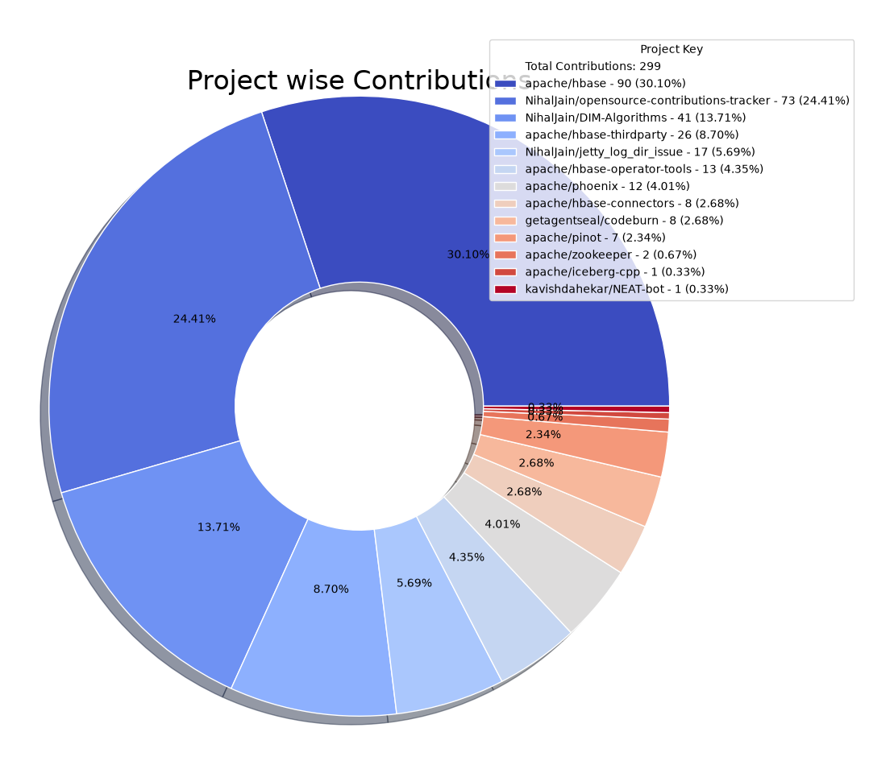
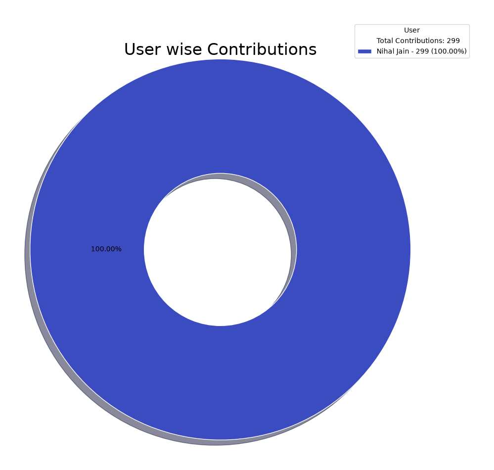

# OpenSource Contributions Report

Report auto-generated on: 2026-10-30 03:48:27

## Overall Summary

| Metric | Value |
|--------|-------|
| Total number of projects | 13 |
| Total number of repositories | 13 |
| Total number of contributions | 299 |
| Number of commits | 288 |
| Number of pull requests (Open) | 11 |

  
  

## Summary of Contributions by each project

| Project Key | Repositories | Users | Commits | Pull Requests (Open) | Overall Contribution |
|--------------|--------------|-------|---------|----------------------|----------------------|
| apache/hbase |  [apache/hbase](https://github.com/apache/hbase) |  [Nihal Jain](https://github.com/NihalJain) | 84 | 6 | 90 |
| NihalJain/opensource-contributions-tracker |  [NihalJain/opensource-contributions-tracker](https://github.com/NihalJain/opensource-contributions-tracker) |  [Nihal Jain](https://github.com/NihalJain) | 73 | 0 | 73 |
| NihalJain/DIM-Algorithms |  [NihalJain/DIM-Algorithms](https://github.com/NihalJain/DIM-Algorithms) |  [Nihal Jain](https://github.com/NihalJain) | 41 | 0 | 41 |
| apache/hbase-thirdparty |  [apache/hbase-thirdparty](https://github.com/apache/hbase-thirdparty) |  [Nihal Jain](https://github.com/NihalJain) | 24 | 2 | 26 |
| NihalJain/jetty_log_dir_issue |  [NihalJain/jetty_log_dir_issue](https://github.com/NihalJain/jetty_log_dir_issue) |  [Nihal Jain](https://github.com/NihalJain) | 16 | 1 | 17 |
| apache/hbase-operator-tools |  [apache/hbase-operator-tools](https://github.com/apache/hbase-operator-tools) |  [Nihal Jain](https://github.com/NihalJain) | 13 | 0 | 13 |
| apache/phoenix |  [apache/phoenix](https://github.com/apache/phoenix) |  [Nihal Jain](https://github.com/NihalJain) | 12 | 0 | 12 |
| apache/hbase-connectors |  [apache/hbase-connectors](https://github.com/apache/hbase-connectors) |  [Nihal Jain](https://github.com/NihalJain) | 8 | 0 | 8 |
| getagentseal/codeburn |  [getagentseal/codeburn](https://github.com/getagentseal/codeburn) |  [Nihal Jain](https://github.com/NihalJain) | 8 | 0 | 8 |
| apache/pinot |  [apache/pinot](https://github.com/apache/pinot) |  [Nihal Jain](https://github.com/NihalJain) | 5 | 2 | 7 |
| apache/zookeeper |  [apache/zookeeper](https://github.com/apache/zookeeper) |  [Nihal Jain](https://github.com/NihalJain) | 2 | 0 | 2 |
| apache/iceberg-cpp |  [apache/iceberg-cpp](https://github.com/apache/iceberg-cpp) |  [Nihal Jain](https://github.com/NihalJain) | 1 | 0 | 1 |
| kavishdahekar/NEAT-bot |  [kavishdahekar/NEAT-bot](https://github.com/kavishdahekar/NEAT-bot) |  [Nihal Jain](https://github.com/NihalJain) | 1 | 0 | 1 |

## Summary of Contributions by each user

| User | Repositories | Commits | Pull Requests (Open) | Overall Contribution |
|------|--------------|---------|----------------------|----------------------|
|  [Nihal Jain](https://github.com/NihalJain) |  [NihalJain/DIM-Algorithms](https://github.com/NihalJain/DIM-Algorithms)  [NihalJain/jetty_log_dir_issue](https://github.com/NihalJain/jetty_log_dir_issue)  [NihalJain/opensource-contributions-tracker](https://github.com/NihalJain/opensource-contributions-tracker)  [apache/hbase](https://github.com/apache/hbase)  [apache/hbase-connectors](https://github.com/apache/hbase-connectors)  [apache/hbase-operator-tools](https://github.com/apache/hbase-operator-tools)  [apache/hbase-thirdparty](https://github.com/apache/hbase-thirdparty)  [apache/iceberg-cpp](https://github.com/apache/iceberg-cpp)  [apache/phoenix](https://github.com/apache/phoenix)  [apache/pinot](https://github.com/apache/pinot)  [apache/zookeeper](https://github.com/apache/zookeeper)  [getagentseal/codeburn](https://github.com/getagentseal/codeburn)  [kavishdahekar/NEAT-bot](https://github.com/kavishdahekar/NEAT-bot) | 288 | 11 | 299 |

## Detailed Contributions

| Project Key | Repository | User | Commits | Pull Requests (Open) | Overall Contribution |
|--------------|------------|------|---------|----------------------|----------------------|
| apache/hbase |  [apache/hbase](https://github.com/apache/hbase) |  [Nihal Jain](https://github.com/NihalJain) | 84 | 6 | 90 |
| apache/hbase-connectors |  [apache/hbase-connectors](https://github.com/apache/hbase-connectors) |  [Nihal Jain](https://github.com/NihalJain) | 8 | 0 | 8 |
| apache/hbase-operator-tools |  [apache/hbase-operator-tools](https://github.com/apache/hbase-operator-tools) |  [Nihal Jain](https://github.com/NihalJain) | 13 | 0 | 13 |
| apache/hbase-thirdparty |  [apache/hbase-thirdparty](https://github.com/apache/hbase-thirdparty) |  [Nihal Jain](https://github.com/NihalJain) | 24 | 2 | 26 |
| apache/iceberg-cpp |  [apache/iceberg-cpp](https://github.com/apache/iceberg-cpp) |  [Nihal Jain](https://github.com/NihalJain) | 1 | 0 | 1 |
| apache/phoenix |  [apache/phoenix](https://github.com/apache/phoenix) |  [Nihal Jain](https://github.com/NihalJain) | 12 | 0 | 12 |
| apache/pinot |  [apache/pinot](https://github.com/apache/pinot) |  [Nihal Jain](https://github.com/NihalJain) | 5 | 2 | 7 |
| apache/zookeeper |  [apache/zookeeper](https://github.com/apache/zookeeper) |  [Nihal Jain](https://github.com/NihalJain) | 2 | 0 | 2 |
| getagentseal/codeburn |  [getagentseal/codeburn](https://github.com/getagentseal/codeburn) |  [Nihal Jain](https://github.com/NihalJain) | 8 | 0 | 8 |
| kavishdahekar/NEAT-bot |  [kavishdahekar/NEAT-bot](https://github.com/kavishdahekar/NEAT-bot) |  [Nihal Jain](https://github.com/NihalJain) | 1 | 0 | 1 |
| NihalJain/DIM-Algorithms |  [NihalJain/DIM-Algorithms](https://github.com/NihalJain/DIM-Algorithms) |  [Nihal Jain](https://github.com/NihalJain) | 41 | 0 | 41 |
| NihalJain/jetty_log_dir_issue |  [NihalJain/jetty_log_dir_issue](https://github.com/NihalJain/jetty_log_dir_issue) |  [Nihal Jain](https://github.com/NihalJain) | 16 | 1 | 17 |
| NihalJain/opensource-contributions-tracker |  [NihalJain/opensource-contributions-tracker](https://github.com/NihalJain/opensource-contributions-tracker) |  [Nihal Jain](https://github.com/NihalJain) | 73 | 0 | 73 |
